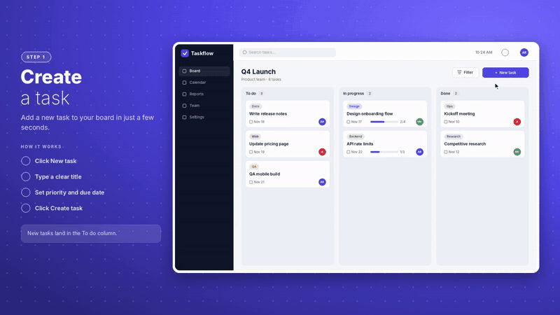
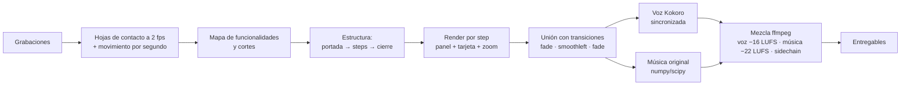

<div align="center">

# 🎬 skill-video

**Una skill para Claude que convierte grabaciones de pantalla en videos de producto con tu marca.**

Tutoriales, actualizaciones de producto ("What's New") y demos para clientes, con checklist animado, zoom suave, voz en off y música original, a partir de una grabación cruda.

[](demo/taskflow-demo.mp4)

<sub>▶️ Haz clic en la animación para ver el video completo con voz y música (43 s · 3,9 MB)</sub>

[**Descargar la skill (.zip)**](https://github.com/mauribeza/video-skill/raw/main/skill-video.zip) · [Ver el SKILL.md](skill-video/SKILL.md) · [Ver el ejemplo](#-ejemplo-incluido-taskflow)

</div>

---

## Contenido

- [¿Qué hace?](#-qué-hace)
- [Instalación](#-instalación)
- [Requisitos](#-requisitos)
- [Cómo usarla](#-cómo-usarla)
- [Ejemplos de prompts](#-ejemplos-de-prompts)
- [Cómo trabaja por dentro](#-cómo-trabaja-por-dentro)
- [Ejemplo incluido: Taskflow](#-ejemplo-incluido-taskflow)
- [Estructura del repositorio](#-estructura-del-repositorio)
- [Preguntas frecuentes](#-preguntas-frecuentes)

---

## ✨ ¿Qué hace?

Le das a Claude una o varias grabaciones de pantalla y los datos de tu marca, y te devuelve un video listo para enviar a un cliente:

| | |
|---|---|
| 🎨 **Diseño de marca** | Fondo degradado con el color de tu marca, tu logo y tu fuente. Portada y cierre animados. |
| ✅ **Checklist animado** | Panel lateral por step con un checklist que se marca justo en el segundo en que ocurre cada acción. |
| ✂️ **Edición limpia** | Corta cargas, spinners, tiempos muertos, desvíos y errores. **Nunca acelera el video.** |
| 🔍 **Zoom inteligente** | Acerca suavemente (~1 s) a formularios, modales y zonas de trabajo, y mantiene el encuadre entre steps. |
| 🎙️ **Voz en off** | Guion sincronizado con la pantalla, generado con [Kokoro](https://github.com/thewh1teagle/kokoro-onnx) (código abierto, Apache 2.0). |
| 🎵 **Música original** | Pista instrumental compuesta con código (sin derechos de autor) que baja sola cuando habla la voz. |
| 📦 **Entregables** | Video completo, cada step por separado, versión sin audio y pista de voz sola. |

---

## 📥 Instalación

### Opción 1 · Claude (web, escritorio o móvil)

1. Descarga [`skill-video.zip`](https://github.com/mauribeza/video-skill/raw/main/skill-video.zip).
2. En Claude, abre la configuración y ve a la sección de **Skills**.
3. Sube el `.zip`. La skill queda disponible en tus conversaciones.

### Opción 2 · Claude Code

```bash
git clone https://github.com/mauribeza/video-skill.git
# Para todos tus proyectos:
cp -r video-skill/skill-video ~/.claude/skills/
# …o solo para un proyecto:
cp -r video-skill/skill-video .claude/skills/
```

### Opción 3 · Descarga manual

Botón verde **Code → Download ZIP** en esta página, o:

```bash
curl -L -o skill-video.zip https://github.com/mauribeza/video-skill/raw/main/skill-video.zip
```

> Lo único imprescindible es la carpeta `skill-video/` con su `SKILL.md`. La carpeta `demo/` es solo el ejemplo.

---

## 🧰 Requisitos

Claude los instala por su cuenta en su entorno, pero si vas a correr el ejemplo en tu máquina necesitas:

| Herramienta | Para qué |
|---|---|
| `ffmpeg` | Cortes, transiciones, codificación H.264 y mezcla de audio |
| Python 3.10+ con `numpy`, `scipy`, `pillow` | Composición de cuadros y música |
| `kokoro-onnx`, `soundfile` | Voz en off |
| Modelos de Kokoro (`kokoro-v1.0.int8.onnx`, `voices-v1.0.bin`) | Se descargan de las [releases de kokoro-onnx](https://github.com/thewh1teagle/kokoro-onnx/releases/tag/model-files-v1.0) |
| Fuente [Inter](https://rsms.me/inter/) (o la de tu marca) | Textos del video |

---

## 🚀 Cómo usarla

1. **Sube tus grabaciones** de pantalla (`.mp4`, `.mov`…) a la conversación.
2. **Dale los datos del proyecto.** Si falta alguno, Claude te lo pregunta o lo busca en tu Figma o tu sitio web:

| Dato | Ejemplo | Por defecto |
|---|---|---|
| Producto / cliente | Taskflow | — |
| Tipo de video | Tutorial · What's New · Demo para cliente | — |
| Funcionalidades a mostrar | Crear tarea, mover tarjetas, filtrar | — |
| Logo | archivo, link de Figma o sitio web | — |
| Color principal / secundarios | `#4F46E5` | — |
| Fuente | Inter | Inter |
| Idioma del video | inglés | inglés |
| Idioma para hablar contigo | español | español |
| Voz en off | sí, femenina | — |
| Música de fondo | sí | — |
| Duración aproximada | 45 s – 3 min | — |

3. **Revisa el análisis.** Antes de editar, Claude te muestra una tabla con todas las funcionalidades que vio en la grabación y te avisa de las que no mencionaste.
4. **Aprueba la estructura** (portada → steps → cierre) y deja que construya.
5. **Pide cambios por step.** Claude edita solo el step afectado y vuelve a unir el video.
6. **Escucha la voz antes de enviar.** Claude no puede oír el audio, así que una persona debe revisarlo.

---

## 💬 Ejemplos de prompts

**Tutorial paso a paso**

```text
Usa skill-video. Te subo 2 grabaciones de Taskflow.
Tipo: tutorial. Funcionalidades: crear tarea, moverla entre columnas y filtrar el tablero.
Color #4F46E5, fuente Inter, logo en https://taskflow.example.com.
Video en inglés, voz femenina, con música, alrededor de 45 segundos.
```

**Actualización de producto (What's New)**

```text
Haz un video "What's New" con skill-video para la versión 2.4 de Orbal.
Muestra solo el nuevo reporte de inventario y la exportación a Excel.
La marca está en este Figma: <link al nodo del logo>. Voz masculina, sin música, máximo 1 minuto.
```

**Demo para un cliente**

```text
Con skill-video, arma una demo para el cliente Ferretería El Roble usando esta grabación.
Quiero que se vea el flujo completo de facturación. Video en español:
elige una voz de Kokoro en español y confírmamela antes de generar todo.
```

**Pedir un cambio**

```text
En el step 2 el zoom entra muy tarde y la frase "Drop it in Done" suena antes de tiempo.
Corrige solo ese step y vuelve a unir el video.
```

---

## ⚙️ Cómo trabaja por dentro



**Especificaciones del video:** 1920×1080 · 30 fps · H.264 `yuv420p` · portada de 3 s · cierre de 5 s · steps de 10 a 25 s · tramos de 1,5 a 6 s.

**Reglas de edición más importantes:**

- ⛔ Nunca adelanta ni acelera: corta y une los tramos con fundidos de 0,35 s.
- ⏱️ Si el corte salta varios minutos, muestra la etiqueta **"A few minutes later"** durante unos 2 s.
- 🚫 Nunca muestra banners de error ni toasts rojos; toma otro momento de la grabación.
- 🧭 Quita navegación innecesaria y desvíos a otras pantallas.
- 🔍 Pantalla completa por defecto; zoom solo para formularios, modales o zonas de trabajo, entrando y saliendo en ~1 s.

El detalle completo está en [`skill-video/SKILL.md`](skill-video/SKILL.md).

---

## 🎥 Ejemplo incluido: Taskflow

El video de esta página se hizo **con esta misma skill**. Para no exponer datos reales, la grabación de entrada es de **Taskflow, una app de tareas ficticia**, generada con código ([`make_recording.py`](demo/scripts/make_recording.py)). La grabación incluye a propósito los problemas que la skill debe resolver:

| Grabación original (3 min 26 s) | Qué hizo la skill |
|---|---|
| 2,6 s de tiempo muerto al inicio | Cortado |
| Spinner de carga (5,6 s – 8,6 s) | Cortado, unido con fundido de 0,35 s |
| Toast rojo de error al guardar (18 s – 21 s) | Cortado; se usa el segundo intento, que sí funciona |
| 2 min 30 s sin actividad | Cortado y marcado con **"A few minutes later"** |
| Desvío a la pantalla *Reports* | Eliminado porque no corresponde al paso |
| Modal de nueva tarea | Zoom suave de entrada y salida (~1 s) |

**Mapa de funcionalidades que generó la skill:**

| Funcionalidad | Dónde se ve | ¿Pedida? |
|---|---|---|
| Crear tarea (New task + modal) | 0:05 – 0:22 | ✅ Step 1 |
| Prioridad y fecha con calendario | 0:14 – 0:17 | ✅ Step 1 |
| Mover tarjetas entre columnas | 0:28 – 0:30 · 3:05 – 3:07 | ✅ Step 2 |
| Barras de progreso de subtareas | tarjetas | ✅ Step 2 |
| Filtro "Assigned to me" | 3:15 – 3:17 | ✅ Step 3 |
| Asignado prellenado, búsqueda, Reports | modal · barra superior · 3:10 | ⚠️ No mencionadas: se preguntaría al desarrollador |

**Resultado:** 43,5 s · 3,9 MB · voz a −16 LUFS · checklist sincronizado con cada acción.

| Portada | Step 1 con zoom al formulario |
|---|---|
|  |  |

### Entregables del ejemplo

| Archivo | Descripción |
|---|---|
| [`demo/taskflow-demo.mp4`](demo/taskflow-demo.mp4) | Video completo con voz y música |
| [`demo/entregables/step1.mp4`](demo/entregables/step1.mp4) · [`step2.mp4`](demo/entregables/step2.mp4) · [`step3.mp4`](demo/entregables/step3.mp4) | Cada step por separado |
| [`demo/entregables/taskflow-demo-sin-audio.mp4`](demo/entregables/taskflow-demo-sin-audio.mp4) | Versión sin audio |
| [`demo/entregables/voz.wav`](demo/entregables/voz.wav) | Pista de voz sola |

### Reproducirlo tú

```bash
git clone https://github.com/mauribeza/video-skill.git
cd video-skill/demo
bash scripts/build.sh      # genera demo/build/final.mp4
```

> Los scripts esperan la fuente Inter en `/usr/share/fonts/opentype/inter/`. Si la tienes en otra ruta, cambia la variable `FD` en `make_recording.py` y `compose.py`.

---

## 📁 Estructura del repositorio

```text
video-skill/
├── README.md
├── skill-video.zip            ← listo para subir a Claude
├── skill-video/
│   └── SKILL.md               ← la skill
└── demo/
    ├── taskflow-demo.mp4      ← video de ejemplo
    ├── preview.gif · poster.png
    ├── entregables/           ← steps, versión sin audio y voz
    └── scripts/
        ├── make_recording.py  ← grabación sintética de prueba
        ├── compose.py         ← portada, steps, panel, zoom y cierre
        ├── voice.py           ← guion y voz con Kokoro
        ├── music.py           ← música original
        └── build.sh           ← todo el proceso de principio a fin
```

---

## ❓ Preguntas frecuentes

**¿Puedo usarla con videos en español u otro idioma?**
Sí. Indica el idioma del video; Claude elige una voz de Kokoro para ese idioma y te la confirma antes de generar todo.

**¿Y si no tengo los datos de marca?**
Pásale el link de tu Figma o de tu sitio web y Claude saca el logo, el color principal y la fuente. Si no los encuentra, te los pregunta. Nunca usa logos de terceros.

**¿La música tiene derechos de autor?**
No. Se compone desde cero con código en cada video, sin samples ni letra.

**¿Puedo pedir solo un cambio sin rehacer todo?**
Sí. Claude edita solo el step afectado y vuelve a unir el video. Si cambia la duración, recalcula los tiempos y regenera la voz.

**¿Por qué tengo que escuchar el video antes de enviarlo?**
Claude verifica cuadros clave, que no haya errores visibles y que las duraciones coincidan, pero no puede oír el audio. Una persona debe confirmar que la voz suena bien.

---

<div align="center">
<sub>Hecho por <a href="https://github.com/mauribeza">@mauribeza</a> · Taskflow es una app ficticia creada para el ejemplo · Voz: Kokoro (Apache 2.0) · Música original generada con código</sub>
</div>
