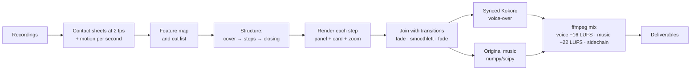
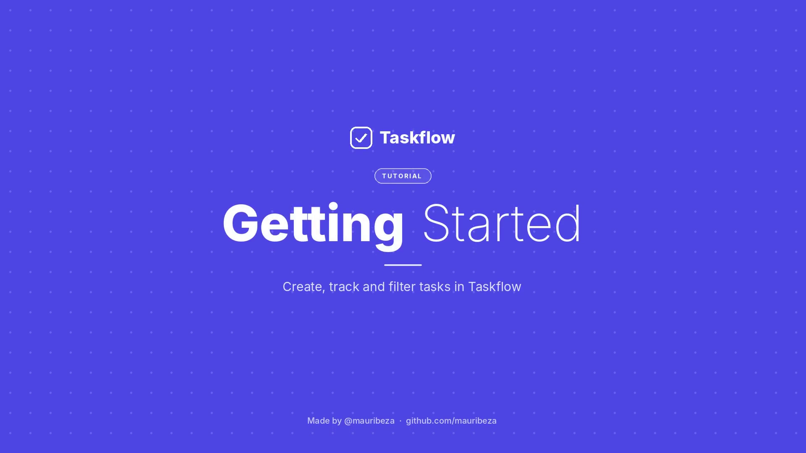

<div align="center">

# 🎬 skill-video

**A Claude skill that turns raw screen recordings into branded product videos.**

Step-by-step tutorials, product updates ("What's New") and client demos, with an animated checklist, smooth zooms, voice-over and original music, all built from a raw recording.

[](demo/taskflow-demo.mp4)

<sub>▶️ Click the animation to watch the full video with voice and music (43 s · 3.5 MB)</sub>

[**Download the skill (.zip)**](https://github.com/mauribeza/video-skill/raw/main/skill-video.zip) · [Read SKILL.md](skill-video/SKILL.md) · [See the example](#-included-example-taskflow)

</div>

---

## Contents

- [What it does](#-what-it-does)
- [Installation](#-installation)
- [Requirements](#-requirements)
- [How to use it](#-how-to-use-it)
- [Prompt examples](#-prompt-examples)
- [How it works](#-how-it-works)
- [Included example: Taskflow](#-included-example-taskflow)
- [Repository structure](#-repository-structure)
- [FAQ](#-faq)

---

## ✨ What it does

Give Claude one or more screen recordings plus your brand details, and you get back a video that is ready to send to a client:

| | |
|---|---|
| 🎨 **Brand design** | Solid background in your brand color, your logo and your font. Animated cover and closing cards. |
| ✅ **Animated checklist** | A side panel for each step, with a checklist that ticks off at the exact second each action happens. |
| ✂️ **Clean editing** | Cuts loading screens, spinners, dead time, detours and errors. **It never speeds up the video.** |
| 🔍 **Smart zoom** | Smoothly zooms (~1 s) into forms, modals and work areas, and keeps the framing consistent between steps. |
| 🎙️ **Voice-over** | A script synced to what happens on screen, generated with [Kokoro](https://github.com/thewh1teagle/kokoro-onnx) (open source, Apache 2.0). |
| 🎵 **Original music** | An instrumental track composed with code (no copyright) that ducks automatically under the voice. |
| 📦 **Deliverables** | Full video, each step as its own clip, a version without audio, and the voice track on its own. |

---

## 📥 Installation

### Option 1 · Claude (web, desktop or mobile)

1. Download [`skill-video.zip`](https://github.com/mauribeza/video-skill/raw/main/skill-video.zip).
2. In Claude, open your settings and go to the **Skills** section.
3. Upload the `.zip`. The skill is now available in your conversations.

### Option 2 · Claude Code

```bash
git clone https://github.com/mauribeza/video-skill.git
# For all your projects:
cp -r video-skill/skill-video ~/.claude/skills/
# …or for a single project:
cp -r video-skill/skill-video .claude/skills/
```

### Option 3 · Manual download

Use the green **Code → Download ZIP** button on this page, or:

```bash
curl -L -o skill-video.zip https://github.com/mauribeza/video-skill/raw/main/skill-video.zip
```

> The only thing you need is the `skill-video/` folder with its `SKILL.md`. The `demo/` folder is just the example.

---

## 🧰 Requirements

Claude installs these on its own in its environment. You only need them if you want to run the example on your machine:

| Tool | Used for |
|---|---|
| `ffmpeg` | Cuts, transitions, H.264 encoding and audio mixing |
| Python 3.10+ with `numpy`, `scipy`, `pillow` | Frame composition and music |
| `kokoro-onnx`, `soundfile` | Voice-over |
| Kokoro models (`kokoro-v1.0.int8.onnx`, `voices-v1.0.bin`) | Downloaded from the [kokoro-onnx releases](https://github.com/thewh1teagle/kokoro-onnx/releases/tag/model-files-v1.0) |
| [Inter](https://rsms.me/inter/) font (or your brand font) | On-screen text |

---

## 🚀 How to use it

1. **Upload your screen recordings** (`.mp4`, `.mov`…) to the conversation.
2. **Give Claude the project details.** If anything is missing, Claude asks you or looks it up in your Figma file or website:

| Detail | Example | Default |
|---|---|---|
| Product / client | Taskflow | — |
| Video type | Tutorial · What's New · Client demo | — |
| Features to show | Create a task, move cards, filter the board | — |
| Logo | file, Figma link or website | — |
| Primary / secondary colors | `#4F46E5` | — |
| Font | Inter | Inter |
| Video language | English | English |
| Language Claude talks to you in | Spanish | Spanish |
| Voice-over | yes, female | — |
| Background music | yes | — |
| Approximate length | 45 s – 3 min | — |

3. **Review the analysis.** Before editing, Claude shows you a table of every feature it found in the recording and flags the ones you didn't mention.
4. **Approve the structure** (cover → steps → closing) and let it build.
5. **Request changes per step.** Claude edits only the affected step and rejoins the video.
6. **Listen to the voice before sending.** Claude can't hear audio, so a person should check it.

---

## 💬 Prompt examples

**Step-by-step tutorial**

```text
Use skill-video. I'm uploading 2 recordings of Taskflow.
Type: tutorial. Features: create a task, move it between columns and filter the board.
Color #4F46E5, Inter font, logo at https://taskflow.example.com.
Video in English, female voice, with music, around 45 seconds.
```

**Product update (What's New)**

```text
Make a "What's New" video with skill-video for Orbal version 2.4.
Show only the new inventory report and the Excel export.
The brand is in this Figma file: <link to the logo node>. Male voice, no music, 1 minute max.
```

**Client demo**

```text
With skill-video, put together a demo for our client using this recording.
I want the full invoicing flow. Video in Spanish:
pick a Kokoro Spanish voice and confirm it with me before generating everything.
```

**Requesting a change**

```text
In step 2 the zoom comes in too late and "Drop it in Done" plays too early.
Fix only that step and rejoin the video.
```

---

## ⚙️ How it works



**Video specs:** 1920×1080 · 30 fps · H.264 `yuv420p` · 3 s cover · 5 s closing · 10–25 s steps · 1.5–6 s shots.

**Key editing rules:**

- ⛔ Never fast-forwards or speeds up: it cuts and joins shots with 0.35 s crossfades.
- ⏱️ If a cut skips several minutes, a **"A few minutes later"** label appears for about 2 s.
- 🚫 Never shows error banners or red toasts; it uses a different moment of the recording instead.
- 🧭 Removes unnecessary navigation and detours to other screens.
- 🔍 Full screen by default; zooms only into forms, modals or work areas, easing in and out in ~1 s.

The full spec lives in [`skill-video/SKILL.md`](skill-video/SKILL.md).

---

## 🎥 Included example: Taskflow

The video at the top of this page was made **with this very skill**. To avoid exposing real data, the input recording is of **Taskflow, a fictional task app** generated with code ([`make_recording.py`](demo/scripts/make_recording.py)). The recording deliberately includes the problems the skill is supposed to fix:

| Original recording (3 min 26 s) | What the skill did |
|---|---|
| 2.6 s of dead time at the start | Cut |
| Loading spinner (5.6 s – 8.6 s) | Cut and joined with a 0.35 s crossfade |
| Red error toast on save (18 s – 21 s) | Cut; the second, successful attempt is used instead |
| 2 min 30 s with no activity | Cut and marked with **"A few minutes later"** |
| Detour to the *Reports* screen | Removed because it doesn't belong to the step |
| New-task modal | Smooth zoom in and out (~1 s) |

**Feature map produced by the skill:**

| Feature | Where it appears | Requested? |
|---|---|---|
| Create a task (New task + modal) | 0:05 – 0:22 | ✅ Step 1 |
| Priority and due date with calendar | 0:14 – 0:17 | ✅ Step 1 |
| Moving cards between columns | 0:28 – 0:30 · 3:05 – 3:07 | ✅ Step 2 |
| Subtask progress bars | cards | ✅ Step 2 |
| "Assigned to me" filter | 3:15 – 3:17 | ✅ Step 3 |
| Prefilled assignee, search, Reports | modal · top bar · 3:10 | ⚠️ Not mentioned: would be confirmed with the developer |

**Result:** 43.5 s · 3.5 MB · voice at −16 LUFS · checklist synced to every action. Every sample video carries a "Made by @mauribeza" credit.

| Cover | Step 1 zooming into the form |
|---|---|
|  |  |

### Example deliverables

| File | Description |
|---|---|
| [`demo/taskflow-demo.mp4`](demo/taskflow-demo.mp4) | Full video with voice and music |
| [`demo/deliverables/step1.mp4`](demo/deliverables/step1.mp4) · [`step2.mp4`](demo/deliverables/step2.mp4) · [`step3.mp4`](demo/deliverables/step3.mp4) | Each step on its own |
| [`demo/deliverables/taskflow-demo-no-audio.mp4`](demo/deliverables/taskflow-demo-no-audio.mp4) | Version without audio |
| [`demo/deliverables/voice.wav`](demo/deliverables/voice.wav) | Voice track only |

### Rebuild it yourself

```bash
git clone https://github.com/mauribeza/video-skill.git
cd video-skill/demo
bash scripts/build.sh      # outputs demo/build/final.mp4
```

> The scripts expect the Inter font in `/usr/share/fonts/opentype/inter/`. If it lives somewhere else, change the `FD` variable in `make_recording.py` and `compose.py`.

---

## 📁 Repository structure

```text
video-skill/
├── README.md
├── skill-video.zip            ← ready to upload to Claude
├── skill-video/
│   └── SKILL.md               ← the skill
└── demo/
    ├── taskflow-demo.mp4      ← example video
    ├── preview.gif · poster.png
    ├── deliverables/          ← steps, no-audio version and voice track
    └── scripts/
        ├── make_recording.py  ← synthetic test recording
        ├── compose.py         ← cover, steps, panel, zoom and closing
        ├── voice.py           ← script and Kokoro voice-over
        ├── music.py           ← original music
        └── build.sh           ← the whole pipeline, end to end
```

---

## ❓ FAQ

**Can I make videos in Spanish or other languages?**
Yes. Tell Claude the video language; it picks a Kokoro voice for that language and confirms it with you before generating everything.

**What if I don't have my brand details at hand?**
Share your Figma link or website and Claude pulls the logo, primary color and font from there. If it can't find them, it asks you. It never uses third-party logos.

**Is the music copyrighted?**
No. It's composed from scratch with code for every video, with no samples and no lyrics.

**Can I ask for one change without redoing everything?**
Yes. Claude edits only the affected step and rejoins the video. If the length changes, it recalculates the timing and regenerates the voice.

**Why do I have to listen to the video before sending it?**
Claude checks key frames, makes sure no errors are visible and that the video and audio lengths match, but it can't hear audio. A person needs to confirm the voice sounds right.

---

<div align="center">
<sub>Made by <a href="https://github.com/mauribeza">@mauribeza</a> · Taskflow is a fictional app created for this example · Voice: Kokoro (Apache 2.0) · Original music generated with code</sub>
</div>
